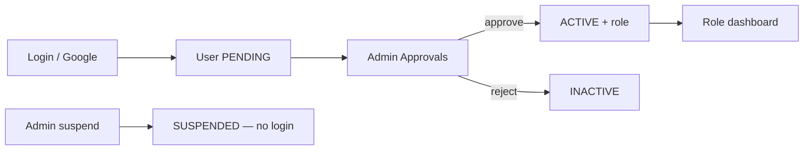

# Doxa Car Hire Management System

Web-based management platform for **Doxa Car Hire Services**.

**Prepared by:** SpectreTech Limited  
**Aligned with:** Solution Design Document v1.0 — July 2026  
**Stack:** Next.js 15 · TypeScript · Tailwind · Prisma · Supabase Auth  

**Dev URL:** [http://localhost:3001](http://localhost:3001)

| Doc | Purpose |
|-----|---------|
| **This README** | What the system is and how it works |
| [docs/BACKEND_SETUP.md](docs/BACKEND_SETUP.md) | How to set up env, Supabase, seed, Resend, Daraja, deploy |
| [docs/DATA_MODEL.md](docs/DATA_MODEL.md) | Tables, relationships, ERD, seed accounts |
| [docs/DESIGN.md](docs/DESIGN.md) | UI / design tokens |

---

## Quick start

### Windows PowerShell

If PowerShell blocks `npm.ps1` because script execution is disabled, use the
included Command Prompt launcher. It does not require changing the Windows
execution policy:

```powershell
.\setup.cmd
.\dev.cmd
```

You can also call npm's Windows executable directly:

```powershell
npm.cmd run dev
```

```bash
npm install
copy .env.local.example .env.local   # fill secrets — see BACKEND_SETUP
npm run db:push
npm run db:seed
npm run db:bootstrap-auth
npm run dev
```

Full setup: **[docs/BACKEND_SETUP.md](docs/BACKEND_SETUP.md)**.  
Seed login accounts (dev only): **[docs/DATA_MODEL.md](docs/DATA_MODEL.md#seeded-dev-accounts)**.

---

## What is built (status)

| Layer | Wired end-to-end? |
|-------|-------------------|
| Next.js 15 + Tailwind + TypeScript | Yes — public site + role dashboards |
| Supabase Auth (`@supabase/ssr`) | Yes — login, register, Google callback, middleware |
| Prisma → Supabase Postgres | Yes — live queries on all dashboards |
| Zod validation | Yes — auth + server actions |
| Chart.js | Yes — dashboard aggregates |
| Resend | Yes — booking confirmations, notifications (skipped if no key) |
| pdf-lib | Yes — receipts, statements, reports |
| M-Pesa Daraja | Yes — STK + callback (needs Daraja env) |
| Shared `/profile` | Yes — all roles |

---

## Project map

```
app/
  (public)/          # Home, about, contact
  admin/             # System admin — staff, approvals, roles, audit logs
  dashboard/
    executive/       # Manager — overview, clients, finance
    treasurer/       # Finance — payments, expenses, notifications
    secretary/       # Dispatch — bookings, check-in/out
    organizer/       # Fleet manager — vehicles, fleet status
    member/          # Staff — home, active bookings
  profile/           # Shared profile (all signed-in users)
  auth/callback/     # Google OAuth exchange
  api/               # auth, pdf, mpesa, export, notifications
components/          # layout, auth, dashboard shell
lib/                 # prisma, auth, email, queries, mpesa
prisma/              # schema + seed
supabase/            # policies.sql, storage.sql
docs/                # setup, data model, design
```

---

## How authentication works



1. **Register** via the Auth modal or Google OAuth. Creates Supabase Auth user + Prisma `users` row with `status = PENDING`.
2. **Admin** approves at `/admin/approvals` → `ACTIVE` with assigned role.
3. **Login** at `/login` (staff) or `/admin/login` (admin). Admin login has no Google button.
4. Middleware reads JWT `app_metadata`: `{ role, status, isSuperAdmin, dashboardAccess }`.
5. **PENDING** → `/pending`. **SUSPENDED** → signed out immediately.
6. **Google:** Auth modal → Supabase OAuth → `/auth/callback` upserts user and redirects.

### Roles and dashboards

| Role | Dashboard | Primary function |
|------|-----------|-----------------|
| ADMIN | `/admin` | System administration, staff management |
| EXECUTIVE | `/dashboard/executive` | Operations management, client overview |
| TREASURER | `/dashboard/treasurer` | Payments, expenses, financial records |
| SECRETARY | `/dashboard/secretary` | Bookings, dispatch, check-in/out |
| ORGANIZER | `/dashboard/organizer` | Fleet management, vehicle tracking |
| MEMBER | `/dashboard/member` | Staff home, active bookings |

---

## How bookings work

1. Dispatch staff creates a booking (client, vehicle, dates, rate, deposit).
2. Vehicle status changes to `HIRED`.
3. Booking confirmation sent via email/SMS.
4. Return reminders dispatched before expected return date.
5. On check-in, actual return date and lateness penalty are recorded.
6. Vehicle status reverts to `AVAILABLE`.
7. Payment recorded; receipt PDF generated.

### Booking extensions

1. Client requests extension → dispatch staff records new return date.
2. Extra days and additional amount calculated automatically.
3. Owner notified of extended hire period.

---

## How finance works

### Payments (income)

1. Finance records payment against a booking (cash, M-Pesa, bank).
2. M-Pesa STK Push: submit phone + amount → Daraja → callback creates payment record.
3. Receipt PDF generated per payment: `/api/pdf/receipt/[paymentId]`.
4. Owner earnings statement: `/api/pdf/statement/[ownerId]`.

### Expenses

1. Finance records vehicle expenses (fuel, maintenance, insurance).
2. Expenses linked to specific vehicle and owner.
3. Profit/Loss report: income minus expenses per period.

---

## How owner statements work

| Output | Route | Built with |
|--------|-------|------------|
| Payment receipt | `/api/pdf/receipt/[id]` | pdf-lib |
| Owner earnings statement | `/api/pdf/statement/[ownerId]` | pdf-lib |
| Owner expense statement | `/api/pdf/expenses/[ownerId]` | pdf-lib |
| Finance export | `/api/export/finance` | CSV/Excel |

---

## How dashboards work

Each role has an overview plus section pages (nav in `lib/dashboard/nav.ts`):

| Role | Sections |
|------|----------|
| Admin | KPIs, staff directory, approvals, roles, audit logs |
| Executive (Manager) | Booking overview, client list, financial summary |
| Treasurer (Finance) | Payment records, expense records, owner statements |
| Secretary (Dispatch) | Active bookings, dispatch queue, check-in |
| Organizer (Fleet) | Vehicle list, fleet status, parked vs hired |
| Member (Staff) | Active bookings assigned to them |

---

## How notifications work

`lib/email/resend.ts` sends emails when `RESEND_API_KEY` + `FROM_EMAIL` are set. SMS via configured SMS API. Triggers:
- Booking confirmation (client)
- Return reminder (client, 24h before)
- Late return alert (staff)
- Owner earnings notification

Missing keys → no-op (no crash).

---

## Scripts

| Command | Description |
|---------|-------------|
| `npm run dev` | Dev server → **:3001** |
| `npm run build` / `start` | Production |
| `npm run lint` | ESLint |
| `npm run db:generate` | Prisma client |
| `npm run db:push` | Sync schema to Supabase |
| `npm run db:migrate` | Versioned migrations |
| `npm run db:seed` | Seed Prisma data |
| `npm run db:bootstrap-auth` | Create/link Supabase Auth users |
| `npm run db:test` | Connection smoke test |
| `npm run db:studio` | Prisma Studio |

---

## Open decisions

1. Hosting domain (recommend Vercel + Supabase).
2. Official domain name for Doxa Car Hire.
3. M-Pesa Paybill/Till details.
4. SMS provider selection (Africa's Talking recommended).
5. Lateness penalty calculation rules.
6. Owner payment disbursement schedule.
