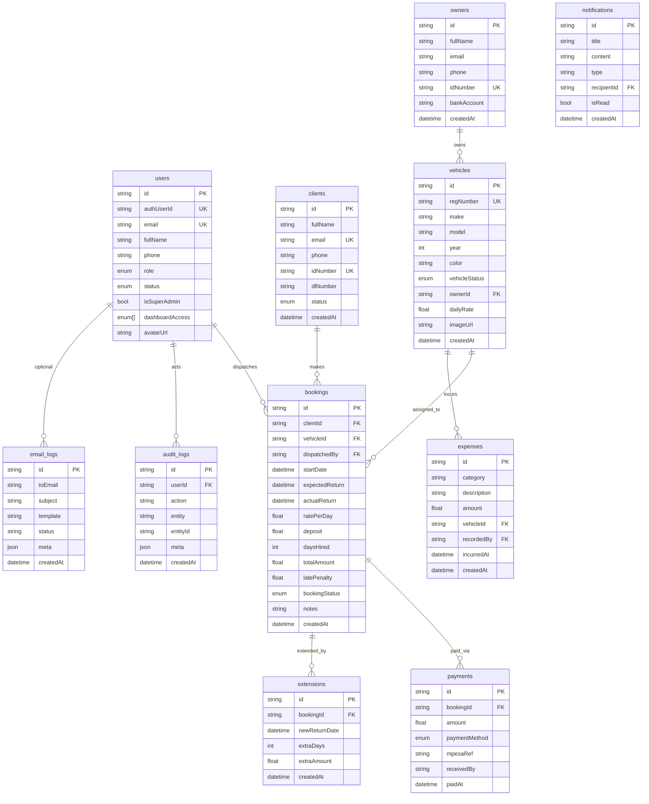

# Doxa Car Hire — Data Model

Car hire management data stored in Postgres: tables, columns, relationships, and how Auth links in.

**Source of truth:** [`prisma/schema.prisma`](../prisma/schema.prisma)  
**Postgres (Supabase)** · table names use `@@map`.  
**ORM:** Prisma · **Auth identities:** Supabase Auth (`auth.users`) linked via `users.authUserId`.

App writes go through Prisma (service connection; bypasses RLS). Browser Supabase clients are RLS-scoped — see [`supabase/policies.sql`](../supabase/policies.sql).

**How features use this data:** root [README](../README.md).  
**How to connect and seed:** [ARCHITECTURE.md](./ARCHITECTURE.md) Part B.

---

## ERD (entity relationships)

---

## Enums

| Enum | Values | Used by |
|------|--------|---------|
| `Role` | `ADMIN`, `EXECUTIVE`, `TREASURER`, `SECRETARY`, `ORGANIZER`, `MEMBER` | `users.role`, `users.dashboardAccess[]` |
| `UserStatus` | `PENDING`, `ACTIVE`, `INACTIVE`, `SUSPENDED` | `users.status` |
| `ClientStatus` | `ACTIVE`, `SUSPENDED` | `clients.status` |
| `VehicleStatus` | `AVAILABLE`, `HIRED`, `MAINTENANCE`, `RETIRED` | `vehicles.vehicleStatus` |
| `BookingStatus` | `ACTIVE`, `EXTENDED`, `RETURNED`, `CANCELLED` | `bookings.bookingStatus` |
| `PaymentMethod` | `CASH`, `MPESA`, `BANK`, `OTHER` | `payments.paymentMethod` |
| `ExpenseCategory` | `FUEL`, `MAINTENANCE`, `INSURANCE`, `REPAIR`, `OTHER` | `expenses.category` |

---

## Tables

### `users` (model `User`)

Staff and admin accounts. One row per person. Linked to Supabase Auth when `authUserId` is set.

| Column | Type | Notes |
|--------|------|--------|
| `id` | String (cuid) | Primary key |
| `authUserId` | String? unique | Supabase `auth.users.id` |
| `email` | String unique | Login |
| `fullName` | String | Display name |
| `phone` | String? | Contact |
| `role` | Role | Primary home dashboard |
| `status` | UserStatus | Gate for login / middleware |
| `isSuperAdmin` | Boolean | Only supers grant Admin roles |
| `dashboardAccess` | Role[] | Extra workspaces beyond primary role |
| `avatarUrl` | String? | Profile image URL |
| `createdAt` / `updatedAt` | DateTime | |

**JWT sync:** On role/status/access changes, `app_metadata` is updated to `{ role, status, isSuperAdmin, dashboardAccess }` for Edge middleware.

---

### `clients` (model `Client`)

Registered car hire clients.

| Column | Type | Notes |
|--------|------|--------|
| `id` | String | PK |
| `fullName` | String | Client full name |
| `email` | String unique | Contact / receipts |
| `phone` | String | Required for SMS |
| `idNumber` | String unique | National ID |
| `dlNumber` | String? | Driving licence number |
| `status` | ClientStatus | Default `ACTIVE` |
| `notes` | String? | Staff notes |
| `createdAt` / `updatedAt` | DateTime | |

**Relations:** owns bookings.

---

### `vehicles` (model `Vehicle`)

Fleet of cars available for hire.

| Column | Type | Notes |
|--------|------|--------|
| `id` | String | PK |
| `regNumber` | String unique | Number plate |
| `make` | String | e.g. Toyota |
| `model` | String | e.g. Fielder |
| `year` | Int | Manufacture year |
| `color` | String | |
| `vehicleStatus` | VehicleStatus | Default `AVAILABLE` |
| `ownerId` | String FK → owners | Vehicle owner |
| `dailyRate` | Float | Hire rate per day (KSh) |
| `imageUrl` | String? | Vehicle photo |
| `createdAt` / `updatedAt` | DateTime | |

**Indexes:** `ownerId`, `vehicleStatus`.

---

### `owners` (model `Owner`)

Vehicle owners who lease their cars through Doxa.

| Column | Type | Notes |
|--------|------|--------|
| `id` | String | PK |
| `fullName` | String | Owner name |
| `email` | String? | For statements |
| `phone` | String | SMS notifications |
| `idNumber` | String unique | National ID |
| `bankAccount` | String? | For earnings disbursement |
| `notes` | String? | |
| `createdAt` / `updatedAt` | DateTime | |

**Relations:** owns vehicles → earnings calculated from vehicle bookings minus expenses.

---

### `bookings` (model `Booking`)

A single hire record from dispatch to return.

| Column | Type | Notes |
|--------|------|--------|
| `id` | String | PK |
| `clientId` | String FK → clients | Who is hiring |
| `vehicleId` | String FK → vehicles | Which vehicle |
| `dispatchedBy` | String FK → users | Staff who created booking |
| `startDate` | DateTime | When vehicle left |
| `expectedReturn` | DateTime | Agreed return date |
| `actualReturn` | DateTime? | Actual return (set on check-in) |
| `ratePerDay` | Float | Rate at time of booking (KSh) |
| `deposit` | Float | Deposit collected |
| `daysHired` | Int | Calculated on return |
| `totalAmount` | Float | Rate × days |
| `latePenalty` | Float | Extra charge if returned late (default 0) |
| `bookingStatus` | BookingStatus | Default `ACTIVE` |
| `notes` | String? | |
| `createdAt` / `updatedAt` | DateTime | |

**Flows:** Create booking → vehicle `HIRED` → extensions? → check-in → `RETURNED` → vehicle `AVAILABLE` → payment record.

---

### `payments` (model `Payment`)

Money received against a booking.

| Column | Type | Notes |
|--------|------|--------|
| `id` | String | PK |
| `bookingId` | String FK → bookings | |
| `amount` | Float | Must be > 0 |
| `paymentMethod` | PaymentMethod | Default `CASH` |
| `mpesaRef` | String? | M-Pesa receipt |
| `receivedBy` | String? | Staff name |
| `paidAt` | DateTime | Payment date |

**Flows:** Finance form / M-Pesa STK Push → row → receipt PDF `/api/pdf/receipt/[id]`.

---

### `extensions` (model `Extension`)

Hire period extensions on an active booking.

| Column | Type | Notes |
|--------|------|--------|
| `id` | String | PK |
| `bookingId` | String FK → bookings | |
| `newReturnDate` | DateTime | Updated return date |
| `extraDays` | Int | Additional days |
| `extraAmount` | Float | Additional charge (KSh) |
| `createdAt` | DateTime | |

---

### `expenses` (model `Expense`)

Costs incurred by a vehicle (reduces owner earnings).

| Column | Type | Notes |
|--------|------|--------|
| `id` | String | PK |
| `category` | ExpenseCategory | Fuel, maintenance, etc. |
| `description` | String | Detail |
| `amount` | Float | KSh |
| `vehicleId` | String FK → vehicles | Which vehicle |
| `recordedBy` | String FK → users | Finance staff |
| `incurredAt` | DateTime | When expense occurred |
| `createdAt` | DateTime | |

---

### `notifications` (model `Notification`)

In-app and push notification records.

| Column | Type | Notes |
|--------|------|--------|
| `id` | String | PK |
| `title` | String | |
| `content` | String | |
| `type` | String | e.g. `BOOKING`, `RETURN_REMINDER`, `PAYMENT` |
| `recipientId` | String FK → users | Target staff member |
| `isRead` | Boolean | Default `false` |
| `createdAt` | DateTime | |

---

### `audit_logs` (model `AuditLog`)

| Column | Type | Notes |
|--------|------|--------|
| `id` | String | PK |
| `userId` | String FK → users | Actor |
| `action` | String | e.g. `BOOKING_CREATE`, `VEHICLE_CHECKIN` |
| `entity` / `entityId` | String? | Target |
| `meta` | Json? | Extra payload |
| `createdAt` | DateTime | |

---

### `email_logs` (model `EmailLog`)

| Column | Type | Notes |
|--------|------|--------|
| `id` | String | PK |
| `toEmail` | String | Recipient |
| `subject` | String | |
| `template` | String? | Template key |
| `status` | String | e.g. `sent`, `failed` |
| `meta` | Json? | Provider IDs, etc. |
| `createdAt` | DateTime | |

---

## Auth vs app data

| Store | What lives there |
|-------|------------------|
| **Supabase Auth** | Email/password or Google identity, session cookies, `app_metadata` claims |
| **`users` table** | Role, status, profile fields, dashboard grants |
| **Storage buckets** | `documents` (private), `vehicles` (public vehicle photos) |

---

## Seeded dev accounts

> **Dev / local only.** Do not use these in production.  
> Created by: `npm run db:seed` + `npm run db:bootstrap-auth`.

| Email | Password | Role | Dashboard |
|-------|----------|------|-----------|
| `superadmin@doxacarhire.com` | `SuperAdmin@2026!` | Super Admin | `/admin` |

No other staff users are seeded. Create Clerk / Yard / Accountant (or custom) roles and invite staff from `/admin/staff`.

Admin login: `/admin/login`.

---

## Changing the schema

1. Edit `prisma/schema.prisma`
2. `npm run db:push` (or `db:migrate`)
3. `npm run db:generate`
4. If RLS column names change, update `supabase/policies.sql` and re-run
5. Update this file and seed if needed
